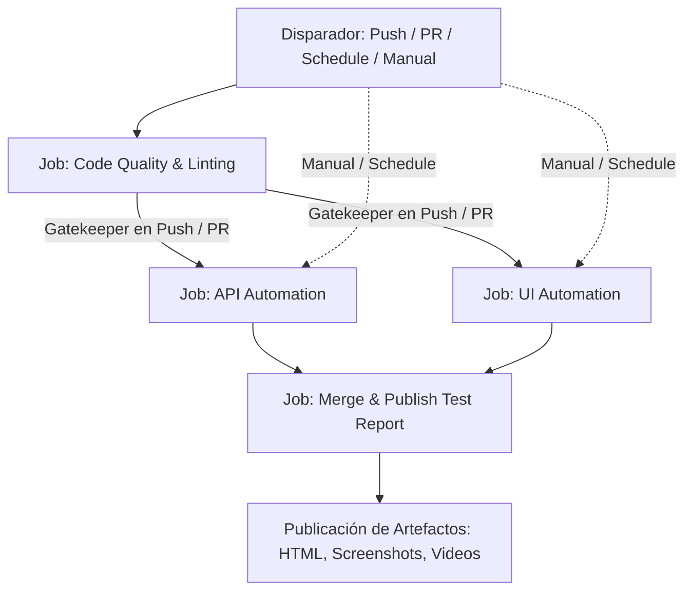

# SDET Technical Challenge – Automation Suite

[](https://github.com/fernando-cotrena/sdet-automation-challenge/actions/workflows/tests.yml)
[](https://www.typescriptlang.org/)
[](https://www.cypress.io/)
[](https://zod.dev/)

Suite de automatización de pruebas end-to-end (API & Web UI) desarrollada en **TypeScript** y **Cypress**, cubriendo:

1. **Parte 1 — API Testing:** Ciclo de vida completo de mascotas y escenarios negativos en **Swagger Petstore** (`/pet`) con validación estricta de contratos con **Zod** y aislamiento total de datos.
2. **Parte 2 — Web Automation:** Flujos de negocio críticos de **Buggy Cars Rating** implementados bajo el patrón **Page Object Model (POM)** combinado con **Fluent Interfaces**, sin esperas fijas y con usuarios dinámicos.
3. **Parte 3 — CI/CD & Reportes:** Pipeline automatizado en **GitHub Actions**, linter, formateador y reportes unificados con **Mochawesome** (capturas de pantalla y evidencias automáticas ante fallos).
4. **Bonus:** Reporte formal de defectos identificados ([`BUGS.md`](./BUGS.md)) y propuesta de estrategia de pruebas extendida.

---

## 🚀 Instalación y Ejecución Local

### Prerrequisitos
- **Node.js:** Versión 18.x o 20.x (LTS recomendado).
- **npm:** Versión 9+ incluida con Node.js.

### 1. Clonar el repositorio e instalar dependencias
```bash
git clone https://github.com/fernando-cotrena/sdet-automation-challenge.git
cd sdet-automation-challenge
npm install
```

### 2. Scripts de Ejecución Disponibles

| Comando | Descripción |
|---|---|
| `npm test` | Ejecuta la suite completa (API y UI) en modo headless |
| `npm run test:api` | Ejecuta exclusivamente la suite de API (Swagger Petstore) |
| `npm run test:ui` | Ejecuta exclusivamente la suite de Web UI (Buggy Cars) |
| `npm run cy:open` | Abre el Cypress Test Runner interactivo |
| `npm run lint` | Ejecuta el análisis estático de código con ESLint |
| `npm run format:check` | Verifica que el código cumpla con el formato de Prettier |
| `npm run report` | Consolida y genera el reporte HTML unificado de Mochawesome |

---

## 🏛️ Arquitectura del Proyecto y Patrones de Diseño

El framework implementa una arquitectura modular con separación clara de responsabilidades:

```text
sdet-automation-challenge/
│
├── .github/workflows/
│   └── tests.yml                 # Pipeline CI/CD en GitHub Actions
│
├── cypress/
│   ├── assertions/                       # Capa dedicada de aserciones (Elimina anti-patrón de POM)
│   │   └── buggy-cars/
│   │       ├── AuthAsserts.ts            # Aserciones de autenticación y sesión
│   │       ├── RegistrationAsserts.ts    # Aserciones de registro y alertas
│   │       └── ModelAsserts.ts           # Aserciones de votación, contadores y comentarios
│   │
│   ├── e2e/
│   │   ├── api/
│   │   │   └── pets/
│   │   │       ├── pet-lifecycle.cy.ts   # Ciclo de vida: Alta, Consulta, Modificación, Baja, 404
│   │   │       └── pet-negative.cy.ts    # Casos negativos: IDs inexistentes, tipos inválidos
│   │   │
│   │   └── ui/
│   │       ├── authentication/
│   │       │   ├── registration.cy.ts    # Registro de usuarios dinámicos
│   │       │   ├── login.cy.ts           # Login exitoso, credenciales inválidas y campos vacíos
│   │       │   └── logout.cy.ts          # Cierre de sesión y retorno a estado anónimo
│   │       └── voting/
│   │           └── voting.cy.ts          # Flujo de negocio: Votación con comentario y verificación
│   │
│   ├── factories/                        # Generación dinámica de datos con Faker.js
│   │   ├── PetFactory.ts                 # IDs únicos por timestamp para entorno compartido
│   │   └── UserFactory.ts                # Usuarios conformes a complejidad de contraseñas
│   │
│   ├── pages/                            # Page Object Model (Puro: solo acciones y navegación)
│   │   └── buggy-cars/
│   │       ├── BasePage.ts               # Elementos comunes, navegación y login/logout
│   │       ├── HomePage.ts               # Acceso a modelos y secciones
│   │       ├── RegistrationPage.ts       # Formulario y envío de datos
│   │       └── ModelPage.ts              # Selección de auto, ingreso de comentarios y voto
│   │
│   ├── schemas/                          # Validación de contratos y schemas
│   │   └── pet/
│   │       └── PetSchema.ts              # Schemas Zod para respuestas exitosas y de error
│   │
│   ├── services/                         # Capa cliente de API (cy.request)
│   │   └── pet/
│   │       └── PetService.ts             # Métodos reutilizables para el endpoint /pet
│   │
│   └── support/
│       ├── commands.ts                   # Custom commands (ej. loginWithSession)
│       ├── e2e.ts                        # Hooks globales y manejo de excepciones no capturadas
│       └── index.d.ts                    # Declaraciones de tipos TypeScript
│
├── reports/                              # Reportes consolidados HTML y JSON (Mochawesome)
├── scripts/
│   └── generate-report.js                # Consolidación robusta y multiplataforma de reportes
├── BUGS.md                               # Reporte detallado de defectos encontrados
├── cypress.config.ts                     # Configuración de entornos, baseUrl y timeouts
├── package.json                          # Scripts y dependencias
└── tsconfig.json                         # Compilación estricta y path aliases
```

### Separación de Responsabilidades: Page Objects vs Page Assertions (Eliminación de Anti-Patrón)

Para mantener una arquitectura escalable, desacoplada y de grado producción, se eliminó el anti-patrón de embeber aserciones (`expect()`, `should()`) dentro de las clases de Page Objects:

1. **Responsabilidad Única (SRP):**
   - **Page Objects (`cypress/pages/`):** Tienen como única responsabilidad modelar los componentes visuales, interactuar con el DOM (escribir, hacer clic, navegar) y exponer el estado. No juzgan el resultado del test.
   - **Page Assertions (`cypress/assertions/`):** Tienen la responsabilidad exclusiva de validar estados esperados, textos, visibilidad e incrementos numéricos.
2. **Mayor Flexibilidad y Reutilización:** Permite reutilizar las mismas acciones de una página en diferentes contextos (flujos exitosos, negativos o exploratorios) sin que una aserción interna rígida bloquee el test.
3. **Legibilidad Expresiva:** Los tests mantienen una lectura clara y fluida, separando las acciones de las verificaciones:
   ```typescript
   // Acción en Page Object
   registrationPage.fillForm(newUser).submit();

   // Validación en Capa de Aserción
   registrationAsserts.assertRegistrationSuccess();
   ```

### ¿Por qué Page Object Model combinado con Fluent Interfaces y Capa de Aserciones?

1. **Abstracción del DOM:** Los tests describen la intención del negocio (`homePage.login()`, `authAsserts.assertLoggedIn()`) en lugar de interactuar directamente con selectores y detalles técnicos de implementación.
2. **Alta legibilidad y fluidez:** El encadenamiento de métodos mediante `this` permite una sintaxis declarativa y fluida que se lee como un caso de prueba en lenguaje natural:
   ```typescript
   registrationPage
     .fillForm(newUser)
     .submit();

   registrationAsserts.assertRegistrationSuccess();
   ```
3. **Mantenibilidad y Escalabilidad:** Si un selector o flujo de la interfaz cambia, solo se modifica el Page Object o la clase de Aserción correspondiente sin alterar la lógica de los tests.

---

## 🔄 Pipeline CI/CD en GitHub Actions

El proyecto implementa un pipeline profesional de Integración Continua ([`.github/workflows/tests.yml`](./.github/workflows/tests.yml)) diseñado para maximizar confiabilidad, velocidad y trazabilidad de ejecuciones.

### 1. Disparadores del Pipeline (`Triggers`)

- **`push`:** Se ejecuta automáticamente ante cada push a la rama `main` y a cualquier rama de características (`feat/**`).
- **`pull_request`:** Se dispara en cada Pull Request con destino a `main`.
- **`schedule` (Regresión Diaria):** Programada para ejecutarse automáticamente todos los días a las **09:00 hora de Argentina (UTC-3)** mediante la expresión cron `0 12 * * *` (12:00 UTC).
- **`workflow_dispatch` (Ejecución Manual):** Permite disparar la suite de forma manual desde la interfaz de GitHub Actions con parámetros configurables.

### 2. Ejecución Manual Parametrizada (`workflow_dispatch`)

Para ejecutar la suite manualmente en GitHub:
1. Ir a la pestaña **Actions** en el repositorio.
2. Seleccionar el workflow **Automated Tests Suite** en el panel izquierdo.
3. Hacer clic en el botón **Run workflow**.
4. Configurar los parámetros:
   - **`suite`** (Selección de Suite):
     - `all`: Ejecuta tanto API como UI y consolida ambos resultados (predeterminado).
     - `api`: Ejecuta únicamente la suite de Swagger Petstore.
     - `ui`: Ejecuta únicamente la suite de Buggy Cars Rating.
   - **`environment`** (Entorno de Destino):
     - `QA`: Entorno por defecto (configurable para apuntar a otros entornos mediante variables).

### 3. Estructura de Jobs del Pipeline



- **`lint` (Code Quality & Linting):**
  - Corre en `ubuntu-latest` con Node.js 22 y caché de dependencias npm.
  - Asegura la existencia de `package-lock.json` para garantizar una instalación determinista con `npm ci`.
  - Ejecuta análisis estático con ESLint (`npm run lint`) y chequeo de formato con Prettier (`npm run format:check`).
  - Actúa como *gatekeeper* en flujos de `push` y `pull_request`.
- **`test-api` (API Automation - Swagger Petstore):**
  - Depende del resultado de `lint` en ejecuciones de `push` y `pull_request`.
  - Se ejecuta en paralelo e independiente de la suite de UI.
  - Genera resultados aislados en `reports/mocha/api/`.
  - Sube los resultados como artefacto (`api-test-results`), incluso si algún test falla (`if: always()`).
- **`test-ui` (UI Automation - Buggy Cars Rating):**
  - Depende del resultado de `lint` en ejecuciones de `push` y `pull_request`.
  - Se ejecuta en paralelo e independiente de la suite de API.
  - Activa la grabación de video en CI (`video: true` bajo entorno CI).
  - Genera resultados aislados en `reports/mocha/ui/`.
  - En caso de fallo, captura y sube automáticamente screenshots (`cypress/screenshots`) y videos (`cypress/videos`).
  - Sube los resultados de ejecución como artefacto (`ui-test-results`), incluso ante fallos (`if: always()`).
- **`generate-report` (Merge & Publish Test Report):**
  - Se ejecuta tras finalizar los jobs de pruebas siempre que al menos una suite haya corrido (`needs.test-api` o `needs.test-ui`).
  - Descarga los artefactos de API y UI en carpetas independientes (`reports/mocha/api` y `reports/mocha/ui`), evitando sobreescritura.
  - Ejecuta el script multiplataforma [`scripts/generate-report.js`](./scripts/generate-report.js), que valida la presencia de resultados, los consolida con `mochawesome-merge` y genera el reporte interactivo con gráficos (`marge`).
  - Publica el reporte HTML consolidado como artefacto descargable (`mochawesome-html-report`) con 14 días de retención.

### 4. Dónde encontrar los Reportes y Evidencias de Ejecución

Al finalizar cualquier ejecución del pipeline en GitHub Actions, en la sección **Artifacts** (al pie de la página del run) se encuentran disponibles:
- **`mochawesome-html-report`:** Archivo comprimido con el reporte HTML interactivo completo, gráficos de torta, tiempos y detalles de cada spec.
- **`ui-failure-screenshots`:** Capturas de pantalla tomadas en el momento exacto de un fallo en la UI.
- **`ui-failure-videos`:** Grabación en video del navegador durante los tests de UI fallidos.
- **`api-test-results` / `ui-test-results`:** Archivos JSON en bruto de Mochawesome para trazabilidad.

### 5. Interpretación de Estados de Jobs

| Estado | Icono | Significado |
|---|---|---|
| **Success** | 🟢 Verde | Todos los tests o validaciones del job se completaron exitosamente. |
| **Failure** | 🔴 Rojo | Uno o más tests fallaron. El reporte y las evidencias (screenshots/videos) se preservan y suben automáticamente. |
| **Skipped** | ⚪ Gris | El job fue omitido intencionalmente (por ejemplo, si en una ejecución manual se seleccionó correr solo `api`, el job de `ui` se muestra como omitido sin afectar el reporte final). |

---

---

## ⚖️ Decisiones Técnicas y Trade-Offs

| Decisión | Justificación | Trade-off asumido |
|---|---|---|
| **Cypress como framework unificado (API & UI)** | Evita fragmentar el repositorio en múltiples herramientas (ej. Playwright para UI y Supertest/Jest para API). Permite un único runner, configuración compartida, mismo pipeline de CI y reportes consolidados. | Cypress corre en el contexto del navegador, lo que impone ciertas restricciones al manejar múltiples pestañas simultáneas (aunque no es necesario para este caso de uso). |
| **Zod para validación de contratos** | Sintaxis declarativa en TypeScript, inferencia automática de tipos (`z.infer`), validación profunda en runtime con mensajes de error explícitos. | Es una dependencia adicional frente a validar propiedades manualmente con assertions simples de Chai, pero otorga robustez de contrato de grado producción. |
| **Generación dinámica con Faker + Timestamps** | Petstore y Buggy Cars son entornos públicos compartidos. Generar IDs con `Date.now() + random` y usuarios únicos por ejecución garantiza que los tests no colisionen ni dependan de estados previos. | Se debe implementar un hook `afterEach` estricto en los tests de API para limpiar la información creada y no saturar el servicio compartido. |
| **Aislamiento sin esperas fijas (`cy.wait(fijo)`)** | Se eliminaron por completo las esperas arbitrarias (`cy.wait(5000)`). Cypress espera naturalmente por estado (`should('be.visible')`, `should('have.class')`) o por respuesta HTTP, acelerando la suite y eliminando flakiness. | Requiere que los selectores y aserciones estén bien diseñados observando cambios de estado reales en el DOM. |
| **`cy.session` para pruebas no enfocadas en auth** | Cuando el objetivo del test no es validar el formulario de login (ej. test de votación), se utiliza `cy.session` para reutilizar el estado de sesión y acelerar la ejecución. | Requiere configurar una función de validación de sesión para recrear cookies/localStorage si expiran. |

---

## 🔍 Hallazgos y Discrepancias en Swagger Petstore API

Durante la implementación de la suite de API se detectaron divergencias entre la especificación OpenAPI de Swagger y la implementación en vivo:
1. **Códigos de error en payloads malformados:** La especificación declara `405 (Invalid input)` para peticiones `POST /pet` con tipos erróneos. Sin embargo, en el servidor público v2, deserializaciones inválidas suelen arrojar `400` o `500` (deserialización Java). El test contempla este comportamiento y valida que la petición sea rechazada correctamente sin forzar un estado arbitrario.
2. **IDs no numéricos:** La documentación indica `400 (Invalid ID supplied)`, mientras que la capa de enrutamiento puede responder `404` ante fallos de coincidencia de ruta al castear el parámetro a `int64`. El test negativo documenta este hallazgo y valida el rechazo del request.

---

## 🧪 Estrategia de Pruebas para Buggy Cars Rating

Si contáramos con un ciclo de desarrollo extendido para Buggy Cars Rating, la estrategia de aseguramiento de calidad se estructuraría según la pirámide de testing:

### 1. Nivel API / Contrato (Mayor retorno de inversión)
- **Autenticación y Sesiones:** Pruebas directas contra los endpoints de autenticación (`/oauth/token` o endpoints REST de login) para verificar caducidad de tokens JWT, refresh tokens e invalidación en logout.
- **Concurrencia e Idempotencia:** Ejecución de pruebas de carrera (race conditions) sobre el endpoint de votos para certificar que un usuario no pueda registrar votos duplicados concurrentemente (ver hallazgos en [BUGS.md](./BUGS.md)).
- **Validación de Límites y Schemas:** Pruebas negativas en API enviando valores de borde en campos de perfil (edad negativa, cadenas extremadamente largas, caracteres especiales).

### 2. Nivel Web UI (E2E)
- **Cross-Browser & Responsive:** Ejecutar la suite en Firefox, WebKit (Safari) y Chrome en diferentes viewports (Desktop vs Mobile) mediante la matriz de ejecución de GitHub Actions.
- **Flujos de Ordenamiento y Paginación:** Cobertura de las tablas de modelos y marcas verificando que los criterios de ordenamiento (por rango, por votos, por modelo) se preserven entre páginas.

### 3. Nivel Performance & Seguridad
- **Pruebas de Carga (k6 / Artillery):** Pruebas de estrés sobre los endpoints de ranking durante eventos simulados de alta votación.
- **Pruebas de Inyección (DAST):** Escaneo con OWASP ZAP para prevenir inyecciones XSS en los campos de comentarios y perfiles.

### 4. ¿Qué dejaríamos fuera de la automatización E2E?
- **Validaciones cosméticas pixel-perfect:** No automatizar por código las posiciones exactas de píxeles o degradados de color (delegar a herramientas de Visual Regression como Percy o Applitools si fuera requerido).
- **Animaciones CSS o transiciones menores:** No ralentizar los pipelines validando la duración exacta de efectos visuales.

---

## 🔮 Qué agregarías o cambiarías con más tiempo

1. **Visual Testing Integrado:** Agregar pruebas de regresión visual automatizadas con Percy o Cypress Image Snapshot para detectar roturas accidentales de maquetación en Buggy Cars.
2. **Mocks y Stubs con `cy.intercept`:** Implementar tests adicionales con interceptores para simular respuestas lentas, caídas del servidor (`500 Internal Server Error`) o microservicios no disponibles.
3. **Matriz de múltiples navegadores en CI:** Configurar el pipeline para correr en paralelo tanto en Electron como en Chrome y Firefox.

---

## 👥 Autor
- **Fernando Cotrena** – *SDET Automation Challenge*
- Repositorio: [github.com/fernando-cotrena/sdet-automation-challenge](https://github.com/fernando-cotrena/sdet-automation-challenge)
